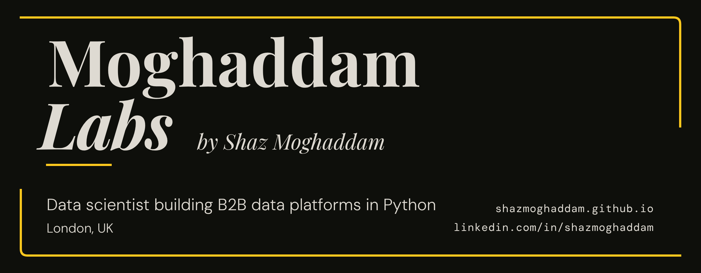

# Moghaddam Labs

Commercial data and AI products for UK businesses, built in London by [Shaz Moghaddam](https://shazmoghaddam.github.io).

Each one starts from a real, messy problem: tax records, climate risk, energy bills, clinical trial data, salary benchmarks. The aim is software that's deployed, tested and usable, not just a demo.

## Products

**[LedgerLet](https://github.com/Moghaddam-Labs/ledgerlet)**: Making Tax Digital for UK landlords. Keeps property records and files quarterly updates straight to HMRC over OAuth, with fraud prevention headers, an append-only audit trail and 600+ tests. [Live demo](https://ledgerlet.onrender.com), running end to end on HMRC's sandbox

**[PerilMap](https://github.com/Moghaddam-Labs/perilmap)**: shows how exposed the area around a home is to flooding, subsidence and heat, before the insurance quote arrives. Postcode search, flood zones on a map and plain-English risk bands, built on Environment Agency data with privacy and WCAG 2.2 AA designed in. [Live site](https://perilmap.vercel.app)

**[VoltEdge](https://github.com/Moghaddam-Labs/voltedge)**: energy intelligence for multi-site operators, with anomaly detection, root-cause analysis, emissions reporting and a Claude assistant that explains what caused a spike. 911 tests. [Live demo](https://voltedge-1k6q.onrender.com)

**[VoltScope](https://github.com/Moghaddam-Labs/voltscope)**: AI extraction and deterministic validation for UK commercial energy bills. The LLM does the reading, plain Python does the checking. The bill-intelligence module of VoltEdge.

**[ClinIQ](https://github.com/Moghaddam-Labs/cliniq)**: clinical trial site performance intelligence for mid-sized CROs, covering enrolment velocity, risk scoring and protocol deviations, with 496 tests.

**[SalaryAxis](https://github.com/Moghaddam-Labs/salaryaxis)**: UK salary benchmarks by region and occupation, built on ONS data and adjusted for inflation, including gender pay gap trends.

## Licensing

The source for these products is published for viewing only. Each repo's LICENSE has the details. For commercial licensing, get in touch.

## Open source

Free and open-source tools, like [Bezel Charts](https://github.com/ShazMoghaddam/bezel-charts) (on npm and PyPI), Bezel and Orbs, live on [Shaz's personal GitHub](https://github.com/ShazMoghaddam).

---

Created by **Shaz Moghaddam** · London\
[Website](https://shazmoghaddam.github.io/) · [LinkedIn](https://www.linkedin.com/in/shazmoghaddam/)
